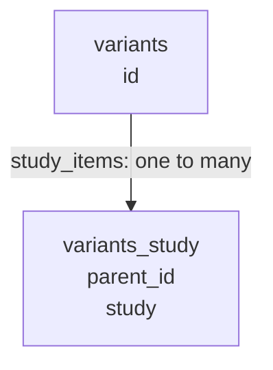

# Relationships and cross-references

Child tables use foreign keys to link each value to its parent row. Cross-references between source entities use names or CUIs; these are exposed as read-only ORM relationships and can resolve to several rows.

## Multi-valued source fields

The loader splits pipe-delimited collections into child rows. For a variant's study references, each row in `variants_study` contains one study token and the parent variant's ID:



`variants_study.parent_id` references `variants.id`. Use `variant.study_items` to read the stored tokens. Each item's `study_objects` resolves its token to matching `Studies` rows, including `study--substudy` references. The same parent/child structure is used for collections on sigs, indications and other entities.

`variant.study_objects` is a separate, generated relationship that matches bare study names only. Use the map item's `study_objects` when references include a substudy.

## Traversal helpers

```python
from hemonc_alchemy.toolkit.core.links import (
    condition_variant_objects,
    sig_condition_objects,
    sig_study_objects,
    study_variant_objects,
)

conditions = sig_condition_objects(sig)
studies = sig_study_objects(sig)
variants = study_variant_objects(study)
```

Keep entities attached to their SQLAlchemy session while using these helpers: resolving related rows can issue additional queries.

## Study references and counts

`Studies.study` is not unique. A study associated with several conditions can have a row for each condition, so a name lookup can return several rows. Use `.scalars().all()` unless your query also constrains the row sufficiently to establish uniqueness.

The study catalogue, sig search, component selection and standalone-radiation queries accept bare study names and `study--substudy` references. So do `Studies.variants` and each variant study-map item's `study_objects`. Other generated name-based relationships compare the stored name literally.

The regimen catalogue's `study_count` counts distinct `Studies.id` values. For example, two condition-specific rows for one study CUI contribute two to that count.

## Study-context filters

For a `study_context` filter, a `StudyResults` row must match the selected `Studies` row on study CUI, substudy CUI, condition CUI and biomarker finding. If the result has no study CUI, its exact study name is used instead. A different, non-NULL CUI cannot match by name. For the substudy, condition and biomarker fields, two NULL values count as equal.

A context field containing `consolidation|maintenance` matches either complete token. Searching for `maintenance` does not match `maintenance extended`; `%` and `_` are treated as literal characters. A filter containing `|` matches only the complete stored field.

## Variant versions and sigs

One `variant_cui` can have several imported versions. The following accessors select them differently:

| Accessor | Selection rule |
| --- | --- |
| `sig.variant_object` | The source-defined current version, `version == 1`; `None` if absent. |
| `study_variant_objects(study)` | Highest `(version, id)` per CUI among variants linked to that study. |
| Catalogue `version_policy="latest"` | Highest `(version, id)` per CUI across all imported variants, selected before study and condition filters. |

The highest numeric version is not the same rule as the source-defined current version. A study-linked historical version can be returned by `study_variant_objects()` even when the catalogue's `latest` selection excludes it.

Sigs store `variant_cui` without a version. The same sigs are therefore associated with every imported variant version sharing that CUI; those links cannot establish which instructions belonged to a particular historical version.
